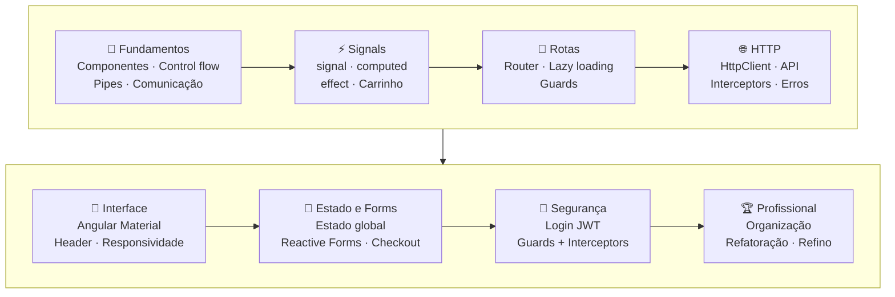

<h1 align="center">🛒 Minha Loja — Angular Moderno na Prática</h1>

<p align="center">
  <strong>Aplicação prática do material didático, do primeiro componente ao e-commerce completo</strong>
</p>

<p align="center">
  Unidade curricular de <strong>Front-end com Angular</strong> · Curso de <strong>Desenvolvedor Fullstack</strong><br/><strong>SENAI Digitech — Centro de Referência em TIC RJ</strong>
</p>

<p align="center">
  
  
  
  
  <br/>
  
  
  
  <br/>
    
</p>

---

## 💡 Sobre este repositório

Este repositório é a **aplicação prática** do material didático que escrevi para a unidade curricular de **Front-end com Angular** do curso de **Desenvolvedor Fullstack** do **SENAI Digitech — Centro de Referência em TIC RJ**.

Aqui o roteiro das apostilas foi percorrido do início ao fim, tema por tema, mostrando a evolução real de um projeto Angular: do primeiro componente a um e-commerce com autenticação, área administrativa e SSR.

O resultado é a **Minha Loja**, um e-commerce completo construído com **Angular 21** e as práticas mais atuais do framework: **componentes standalone, Signals, novo control flow (`@if` / `@for`), lazy loading, guards e interceptors funcionais, Reactive Forms, Angular Material e renderização no servidor (SSR)**.

Este é o projeto que o aluno termina o curso sabendo construir sozinho: uma aplicação com cara de produto real, organizada como em uma equipe profissional.

## ✨ O que a aplicação faz

| Funcionalidade | Descrição |
|---|---|
| 🏠 **Home** | Página inicial da loja |
| 🛍️ **Catálogo de produtos** | Produtos carregados de uma API REST real ([Fake Store API](https://fakestoreapi.com)) via `HttpClient` |
| 🛒 **Carrinho de compras** | Adiciona e remove itens e calcula o total em tempo real com **Signals** e `computed()`. O carrinho persiste no `localStorage` |
| 🔐 **Login com JWT** | Autenticação simulada com token JWT e perfis de **usuário** e **administrador** |
| 🧾 **Checkout** | Formulário reativo com validações (`required`, `minLength`, `email`) |
| 🛡️ **Área administrativa** | Rota protegida, acessível somente ao perfil admin |
| 🚫 **Acesso negado** | Redirecionamento automático quando o usuário não tem permissão |
| 📱 **Interface responsiva** | Layout com Angular Material, header com menu e foco em UX |

## 🧠 Conceitos de Angular moderno aplicados

<table>
<tr>
<td valign="top" width="50%">

**⚡ Reatividade com Signals**
- `signal()`, `computed()` e `effect()`
- Estado global do carrinho e da autenticação em services com Signals
- Persistência automática com `effect()` + `localStorage`

**🧩 Componentes**
- Componentes **standalone**
- Comunicação pai ↔ filho com `@Input()` e `@Output()` / `EventEmitter`
- Novo control flow: `@if`, `@else` e `@for`
- Pipes nativos (`CurrencyPipe`) e **pipe customizado** (`precoFormatado`)

**🧭 Rotas**
- `provideRouter` com rotas do e-commerce
- **Lazy loading** com `loadComponent`
- **Guards funcionais** (`authGuard`, `adminGuard`) com `createUrlTree`

</td>
<td valign="top" width="50%">

**🌐 HTTP e integração**
- `provideHttpClient(withFetch(), withInterceptors(...))`
- **Interceptor funcional** que injeta o header `Authorization: Bearer`
- Tratamento centralizado de erros **401, 403 e 500**

**📝 Formulários**
- **Reactive Forms** com `FormGroup` e `FormControl`
- Validações e mensagens de erro no checkout

**🏗️ Arquitetura profissional**
- Organização em `core/`, `features/` e `shared/`
- Padrão **Facade** (`AuthFacade`, `CarrinhoFacade`) separando a UI da lógica
- Models tipados com TypeScript

**🚀 Produção**
- **SSR** com `@angular/ssr` + Express e hidratação com `withEventReplay()`
- Código seguro para SSR com `isPlatformBrowser`
- Testes unitários com **Vitest**

</td>
</tr>
</table>

## 🗺️ Trilha de aprendizagem

Cada commit corresponde a um tema do material ("Componente Produto", "Introdução ao Router", "Reactive Forms", "Login com JWT"…), na mesma ordem das aulas. O [histórico de commits](../../commits/main) funciona como um passo a passo do curso.



| Módulo | Aulas | Conteúdo |
|---|:---:|---|
| 🧩 Fundamentos | 04 – 07 | Componentes, controle de fluxo, pipes, comunicação entre componentes e estrutura do projeto |
| ⚡ Signals | 08 – 11 | Introdução a Signals, writable e computed signals, effects e carrinho de compras com Signals |
| 🧭 Rotas | 12 – 15 | Router, rotas do e-commerce, lazy loading com `loadComponent`, guards e segurança de rotas |
| 🌐 HTTP | 16 – 20 | HttpClient, consumo de API em service, interceptors e tratamento de erros |
| 🎨 Interface | 21 – 23 | Angular Material, interface e header com menu, responsividade e UX |
| 📝 Estado e formulários | 24 – 27 | Estado global com Signals e services, Reactive Forms, validações e formulário de checkout |
| 🔐 Segurança | 28 – 30 | Login com JWT, guards + interceptors para proteger a área admin e controle de acesso |
| 🏆 Acabamento profissional | 31 – 34 | Organização profissional, refatoração, finalização funcional e refino final |

## 📂 Estrutura do projeto

```
src/app/
├── core/                      # Núcleo da aplicação (singleton)
│   ├── facades/               # AuthFacade, CarrinhoFacade
│   ├── interceptors/          # http.interceptor.ts (token + erros)
│   ├── models/                # ProdutoLoja, ItemCarrinho
│   ├── services/              # AuthService, CarrinhoService, ProdutosService
│   ├── auth.guard.ts
│   └── admin.guard.ts
├── features/                  # Telas da aplicação (lazy loaded)
│   ├── home/
│   ├── produtos/              # lista-produtos + produto
│   ├── carrinho/
│   ├── checkout/
│   ├── login/
│   ├── admin/
│   └── acesso-negado/
├── shared/                    # Reutilizáveis
│   ├── layout/header/
│   └── pipes/preco-formatado-pipe.ts
├── app.config.ts              # Providers: router, HttpClient, interceptors, hydration
└── app.routes.ts              # Rotas com loadComponent e guards
```

## 🚀 Como executar

**Pré-requisitos:** Node.js (LTS) e Angular CLI 21.

```bash
git clone https://github.com/fabcurvello/meu-primeiro-app.git
cd meu-primeiro-app
npm install
npm start
```

Acesse **http://localhost:4200**.

| Comando | O que faz |
|---|---|
| `npm start` | Servidor de desenvolvimento |
| `npm run build` | Build de produção (com SSR) |
| `npm run serve:ssr:meu-primeiro-app` | Executa a versão SSR compilada com Express |
| `npm test` | Testes unitários com Vitest |

### 🔑 Como testar o login

O login é **simulado** para fins didáticos e aceita qualquer e-mail e senha:

| Perfil | E-mail | Acesso |
|---|---|---|
| 👤 Usuário | qualquer e-mail | Catálogo, carrinho e checkout |
| 🛡️ Administrador | `admin@email.com` | Tudo acima + área **/admin** |

## 👨‍🏫 Sobre o autor

**Fabricio Curvello** é desenvolvedor e professor de desenvolvimento de software, e o **autor do material didático** da unidade curricular de Front-end com Angular do curso de Desenvolvedor Fullstack do SENAI Digitech.

Leciona no SENAI-RJ desde 1997, em cursos de programação, banco de dados, web e desenvolvimento fullstack, e no Centro Universitário IBMR desde 2018, nos cursos de Análise e Desenvolvimento de Sistemas, Ciência da Computação e Gestão de TI.

No front-end, ensina Angular do jeito que o mercado usa hoje: Signals, standalone, SSR e uma arquitetura organizada desde a primeira linha. O aluno não aprende só a fazer funcionar, aprende a fazer do jeito certo.

<p align="left">
  <a href="https://www.linkedin.com/in/fabriciocurvello"></a>
  <a href="https://www.youtube.com/@fabriciocurvello"></a>
  <a href="https://github.com/fabcurvello"></a>
  <a href="http://lattes.cnpq.br/2406072276749635"></a>
</p>

---

<p align="center">
  Material didático da unidade curricular de Front-end com Angular — Curso de Desenvolvedor Fullstack<br/>
  <strong>SENAI Digitech — Centro de Referência em TIC RJ</strong>
</p>
